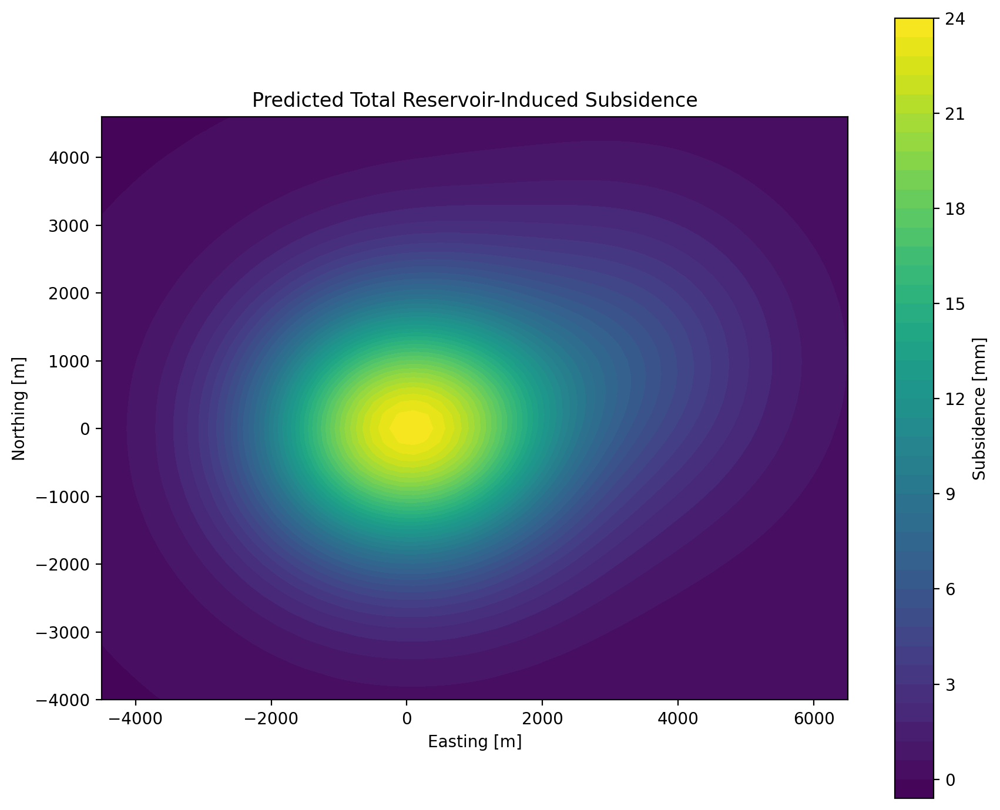
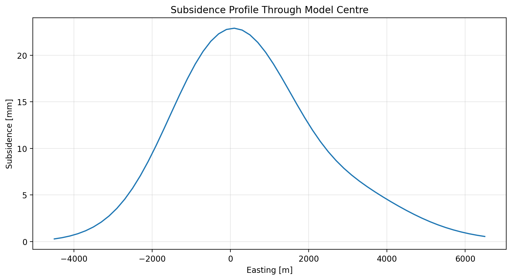
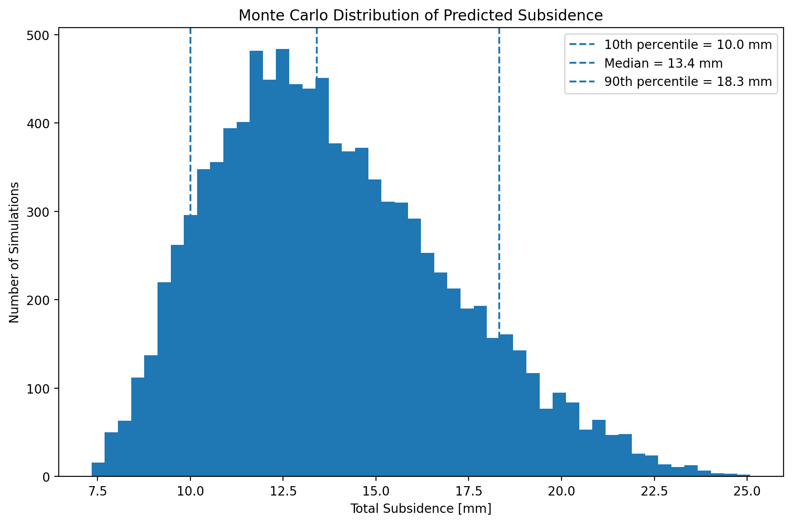
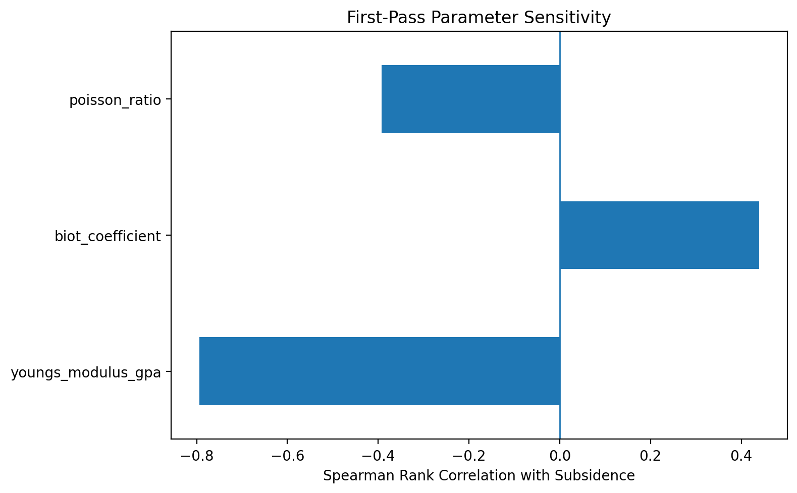
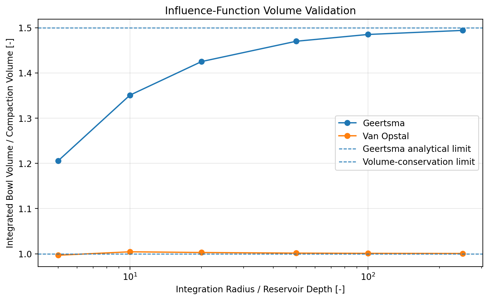
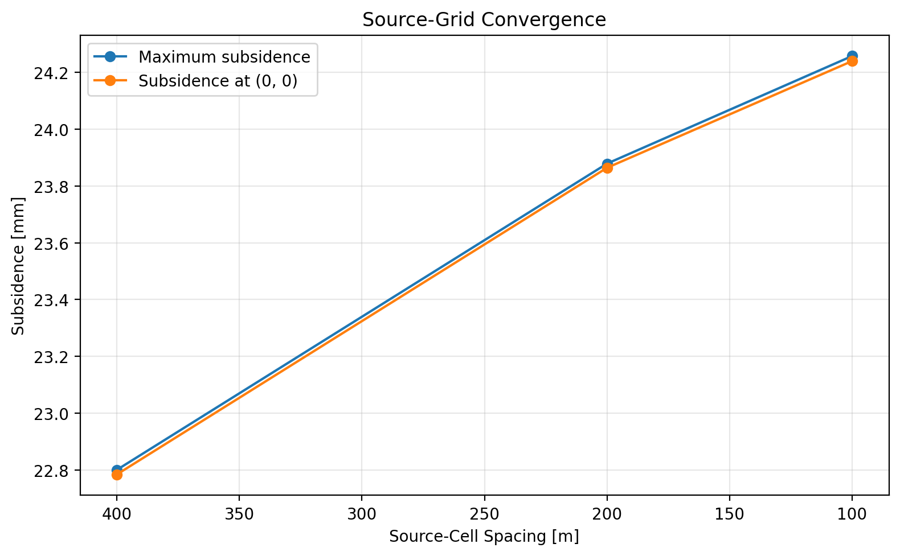

# Subsidence Modelling

Python implementation of **Geertsma–Van Opstal subsidence modelling**.

All examples in this repository use **synthetic data**.



## Overview

Pressure depletion increases effective stress in a reservoir and cause reservoir-rock compaction. That compaction is transferred through the surrounding rock mass and can result in measurable surface subsidence.

The workflow implemented here is:

```text
Pressure depletion
        ↓
Reservoir compaction
        ↓
Geertsma influence function
        ↓
Van Opstal rigid-basement correction
        ↓
Spatial superposition
        ↓
Surface subsidence
        ↓
Visualization and uncertainty analysis
```

The spatial model operates on individual source cells, allowing pressure depletion, thickness, compaction coefficient, depth, and reservoir geometry to vary spatially.

## Key Features

- Cell-based reservoir compaction
- Geertsma nucleus-of-strain formulation
- Van Opstal rigid-basement correction
- Multiple reservoirs and linear superposition
- Spatially variable pressure depletion
- Vectorized NumPy calculations over surface evaluation points
- Subsidence contour maps and profiles
- Synthetic reproducible datasets
- Monte Carlo uncertainty screening
- Parameter-sensitivity analysis
- Automated physical and numerical tests

---

## Methodology

### 1. Reservoir Compaction

The reservoir is discretized into compacting source cells. For source cell $i$, the compaction volume is calculated using

```math
\Delta V_i
=
A_i h_i C_{m,i}\Delta p_i
```

where:

- $A_i$ = horizontally projected source-cell area [m²]
- $h_i$ = net compacting reservoir thickness [m]
- $C_{m,i}$ = uniaxial compaction coefficient [1/bar]
- $\Delta p_i$ = positive pressure depletion [bar]
- $\Delta V_i$ = compaction volume [m³]

The implementation expects pressure depletion in **bar** and the compaction coefficient in **1/bar**. No implicit pressure-unit conversion is applied.

If gross reservoir thickness is used instead of net compacting thickness, the appropriate net-to-gross or compacting fraction should be applied before calculating $\Delta V_i$.

### 2. Source-Cell Geometry

Each reservoir cell is represented as a point compaction source located at

```math
(x_i, y_i, z_i)
```

where $z_i$ is the positive depth below surface to the representative source location. In the present implementation, this is interpreted as the **source-cell centre depth**.

For a surface observation point $(x,y)$, the horizontal source-to-observation distance is

```math
R_i(x,y)
=
\sqrt{
(x-x_i)^2+(y-y_i)^2
}
```

The point-source approximation becomes increasingly accurate as source-cell dimensions become small relative to reservoir depth and to the spatial scale over which the subsidence field varies.

### 3. Geertsma Influence Function

For a homogeneous, isotropic, linear-elastic half-space, the Geertsma vertical influence function for source cell $i$ is

```math
G_{G,i}(x,y)
=
\frac{1-\nu}{\pi}
\frac{z_i}
{\left[R_i(x,y)^2+z_i^2\right]^{3/2}}
```

where $\nu$ is Poisson's ratio.

The influence function has units of inverse area. Multiplying it by source-cell compaction volume gives a vertical surface-displacement contribution:

```math
s_{G,i}(x,y)
=
\Delta V_i
G_{G,i}(x,y)
```

The sign convention used throughout the repository is:

- pressure depletion: positive
- compaction volume: positive
- subsidence: positive downward

### 4. Van Opstal Rigid-Basement Correction

The Van Opstal formulation extends the Geertsma half-space solution by introducing image terms that represent a mechanically rigid basement beneath the reservoir.

For source cell $i$,

```math
G_{VO,i}(x,y)
=
G_{G,i}(x,y)
+
\Delta G_{RB,i}(x,y)
```

where $\Delta G_{RB,i}$ is the rigid-basement correction.

The correction depends on:

- horizontal distance $R_i$
- reservoir source depth $z_i$
- rigid-basement depth $z_{b,i}$
- Poisson's ratio $\nu$
- the Van Opstal image coefficients

The coefficient set implemented in this repository is:

| Coefficient | Value |
|---|---:|
| $a_{11}$ | 1.000 |
| $a_{12}$ | -0.778 |
| $a_{21}$ | 2.000 |
| $a_{22}$ | 2.800 |
| $b_{11}$ | -0.200 |
| $b_{21}$ | 4.000 |

These coefficients are used with

```math
\nu = 0.25
```

and the implementation rejects other Poisson-ratio values for the Van Opstal calculation.

The complete image-term implementation is provided in:

`src/reservoir_subsidence/van_opstal.py`

In the synthetic example, rigid-basement depth is parameterized as

```math
z_{b,i}
=
f_{RB,j} z_i
```

where $f_{RB,j}$ is the rigid-basement factor assigned to reservoir $j$.

This allows different reservoirs to use different rigid-basement assumptions.

### 5. Surface Subsidence

The Van Opstal-corrected contribution from source cell $i$ is

```math
s_i(x,y)
=
\Delta V_i
G_{VO,i}(x,y)
```

Because the analytical model is linear, the response from all source cells can be superimposed:

```math
s_j(x,y)
=
\sum_{i=1}^{N_j}
\Delta V_i
G_{VO,i}(x,y)
```

where $N_j$ is the number of source cells belonging to reservoir $j$.

For multiple reservoirs, the total response is

```math
s_{\mathrm{total}}(x,y)
=
\sum_{j=1}^{N_{\mathrm{reservoirs}}}
s_j(x,y)
```

Linear elasticity is therefore the basis for superposition both within individual reservoirs and between reservoirs.

---

## Example Results

The synthetic example contains two depleted reservoirs with different geometries, depths, pressure-depletion patterns, and compaction properties.

### Total Subsidence


### Subsidence Profile



The profile provides a direct view of bowl width, peak displacement, and interaction between neighbouring reservoir contributions.

---

## Uncertainty Analysis

A separate screening workflow explores how uncertainty in basic reservoir poroelastic properties propagates into predicted subsidence.

This calculation uses the homogeneous **Geertsma solution without the Van Opstal rigid-basement correction**. It is therefore intended as an analytical uncertainty-screening model rather than as a replacement for the spatial Van Opstal calculation.

### From Elastic Properties to Compaction

For isotropic linear-elastic material under uniaxial-strain conditions, the constrained modulus is

```math
M=
\frac{E(1-\nu)}
{(1+\nu)(1-2\nu)}
```

where:

- $E$ = static drained Young's modulus
- $\nu$ = drained Poisson's ratio

The corresponding vertical reservoir compaction is approximated by

```math
\Delta h=
\frac{\alpha_B\,\Delta p\,h}{M}
```

where $\alpha_B$ is the Biot coefficient.

This can also be written using an equivalent uniaxial compaction coefficient:

```math
C_m=\frac{\alpha_B}{M}
```

so that

```math
\Delta h=C_m\Delta p\,h
```

This relationship provides the connection between the poroelastic parameters sampled in the uncertainty analysis and the compaction coefficient used in the spatial model.

### Circular-Reservoir Screening Solution

For an idealized circular reservoir of radius $R$ at depth $z$, the Geertsma centre-point subsidence estimate is

```math
s=
2(1-\nu)\Delta h
\left(
1-
\frac{z}
{\sqrt{z^2+R^2}}
\right)
```

This expression can be obtained by integrating the Geertsma point-source influence function over a uniformly compacting circular reservoir.

For very large radius-to-depth ratio,

```math
\frac{R}{z}\rightarrow\infty
```

the centre-point response approaches

```math
s\rightarrow2(1-\nu)\Delta h
```

which becomes $1.5\Delta h$ for $\nu=0.25$.

### Monte Carlo Sampling

The synthetic example uses independent uniform sampling:

| Parameter | Range |
|---|---:|
| Young's modulus $E$ | 8–15 GPa |
| Poisson's ratio $\nu$ | 0.20–0.30 |
| Biot coefficient $\alpha_B$ | 0.70–1.00 |

The calculation uses:

- **10,000 Monte Carlo realizations**
- a fixed random seed of **42**
- independent sampling of $E$, $\nu$, and $\alpha_B$

Reservoir pressure depletion, thickness, depth, and radius are treated as deterministic in this screening example.

The sampled Poisson-ratio interval is kept well below the incompressible limit $\nu=0.5$, at which the constrained modulus becomes singular.

For simplicity, one sampled $E$–$\nu$–$\alpha_B$ triplet is applied to all reservoirs within each Monte Carlo realization. This implies fully correlated elastic/poroelastic properties across the synthetic reservoirs in the current demonstration.

### Relationship to the Spatial Model

The uncertainty-screening model and the spatial Van Opstal model serve different purposes.

The spatial model uses a Van Opstal rigid-basement correction and currently fixes

```math
\nu=0.25
```

because the implemented image-term coefficient set corresponds to that value.

The screening model uses the homogeneous Geertsma solution and allows $\nu$ to vary. It therefore explores a sensitivity that the current spatial Van Opstal implementation does not directly propagate.

The two calculations should not be interpreted as directly equivalent predictions.

The main purpose of the uncertainty workflow is to:

- quantify how elastic-property uncertainty translates into uncertainty in $C_m$;
- identify which sampled parameters most strongly influence the analytical response;
- provide a basis for future uncertainty propagation through the full spatial model.

Dynamic elastic moduli derived from sonic measurements may differ significantly from static deformation moduli and should be converted using an appropriate formation-specific relationship before being used in this calculation.

### Monte Carlo Distribution



### Parameter Sensitivity



Spearman rank correlation is used as a first-pass indicator of the relative influence of the sampled parameters on predicted subsidence. The sensitivities apply only to the synthetic parameter ranges used in the example.

---

## Model Assumptions

The current implementation assumes:

- linear reservoir compaction;
- uniaxial, laterally constrained reservoir compaction;
- a homogeneous, isotropic, linear-elastic medium in the underlying Geertsma formulation;
- a mechanically rigid basement in the Van Opstal extension;
- Poisson's ratio $\nu=0.25$ for the implemented Van Opstal coefficient set;
- linear superposition of source-cell responses;
- point-source representation of individual reservoir cells;
- positive pressure depletion and positive downward subsidence;
- prescribed reservoir and basement depths.

The model does not explicitly represent:

- faults or mechanical discontinuities;
- elastic layering in the overburden;
- nonlinear rock behaviour;
- viscoelastic deformation;
- delayed compaction;
- poroelastic coupling outside the prescribed reservoir-compaction field.

---

## Numerical Discretization

Each reservoir grid cell is represented by a point compaction source located at the cell centre.

This is a numerical approximation to the spatial integration of reservoir compaction. The approximation improves as source-cell dimensions decrease relative to reservoir depth and the characteristic dimensions of the reservoir.

A source-grid refinement study is therefore recommended when the model is used quantitatively.

---

## Validation

The repository includes both automated tests and explicit numerical validation studies.

### Influence-Function Volume Validation

For an axisymmetric unit-compaction source, the integrated surface response is evaluated numerically as

```math
\frac{V_{\mathrm{subs}}}{V_{\mathrm{comp}}}
=
\int_0^{R_{\max}} 2\pi r\,G(r)\,dr
```

For the homogeneous Geertsma solution,

```math
\frac{V_{\mathrm{subs}}}{V_{\mathrm{comp}}}
\rightarrow
2(1-\nu)
```

which equals **1.5** for $\nu=0.25$.

For the Van Opstal rigid-basement formulation, the integrated response should approach **1.0**, corresponding to volume conservation.

The implemented numerical validation gives, at an integration radius of 250 reservoir depths:

| Model | Numerical ratio | Expected limit |
|---|---:|---:|
| Geertsma | 1.4940 | 1.5000 |
| Van Opstal | 1.0007 | 1.0000 |



The remaining Geertsma difference is dominated by finite-domain truncation of the long-range elastic tail.

### Source-Grid Convergence

The synthetic two-reservoir model is recalculated with source-cell spacings of 400 m, 200 m, and 100 m while holding the surface evaluation grid fixed at 200 m.

| Source spacing | Source cells | Maximum subsidence | Error vs. 100 m |
|---:|---:|---:|---:|
| 400 m | 57 | 22.80 mm | 6.01% |
| 200 m | 241 | 23.88 mm | 1.56% |
| 100 m | 1000 | 24.26 mm | reference |



The refinement study also captures changes in discretized reservoir area and total compaction as the synthetic elliptical reservoir boundaries are represented more finely.

For this synthetic case, the 200 m source grid is within approximately **1.6%** of the 100 m reference for peak subsidence.

### Automated Tests

The test suite checks:

- zero depletion produces zero compaction;
- compaction varies linearly with depletion;
- Geertsma response is radially symmetric;
- Van Opstal response is radially symmetric;
- influence decreases toward the far field;
- source contributions superimpose linearly;
- Geertsma integrated bowl volume approaches $2(1-\nu)$;
- Van Opstal integrated bowl volume approaches volume conservation;
- source-grid refinement reduces peak-subsidence error;
- Monte Carlo calculations are reproducible;
- invalid elastic-property ranges are rejected.

Run:

```bash
pytest -q
```

Detailed validation calculations are provided in `notebooks/03_validation.ipynb`.

---

## Repository Structure

```text
reservoir-subsidence/
│
├── README.md
├── pyproject.toml
├── requirements.txt
├── .gitignore
│
├── data/
│   ├── synthetic_reservoir.csv
│   ├── synthetic_uncertainty_reservoirs.csv
│   ├── source_grid_convergence.csv
│   └── volume_validation.csv
│
├── examples/
│   └── run_subsidence.py
│
├── figures/
│   ├── total_subsidence_map.png
│   ├── subsidence_center_profile.png
│   ├── uncertainty_distribution.png
│   ├── uncertainty_sensitivity.png
│   ├── source_grid_convergence.png
│   └── volume_validation.png
│
├── notebooks/
│   ├── 01_van_opstal_subsidence.ipynb
│   ├── 02_uncertainty_analysis.ipynb
│   └── 03_validation.ipynb
│
├── src/
│   └── reservoir_subsidence/
│       ├── __init__.py
│       ├── compaction.py
│       ├── grid.py
│       ├── uncertainty.py
│       ├── validation.py
│       ├── van_opstal.py
│       └── visualization.py
│
└── tests/
    ├── test_compaction.py
    ├── test_uncertainty.py
    ├── test_validation.py
    └── test_van_opstal.py
```

---

## Installation

```bash
git clone https://github.com/asengel/reservoir-subsidence.git
cd reservoir-subsidence
python -m venv .venv
```

Activate the environment.

Windows:

```powershell
.venv\Scripts\Activate.ps1
```

Linux/macOS:

```bash
source .venv/bin/activate
```

Install the package and development dependencies:

```bash
pip install -e ".[dev]"
```

---

## Run the Example

```bash
python examples/run_subsidence.py
```

Generated result tables are excluded from version control.

---

## Jupyter Notebooks

### `01_van_opstal_subsidence.ipynb`

Main spatial modelling workflow:

- inspect synthetic input data;
- calculate cell-wise compaction;
- create the surface grid;
- calculate individual reservoir contributions;
- calculate total subsidence;
- visualize subsidence maps and profiles;
- interpret the result.

### `02_uncertainty_analysis.ipynb`

Uncertainty-screening workflow:

- define elastic and poroelastic parameter ranges;
- run reproducible Monte Carlo sampling;
- derive an equivalent $C_m$ distribution;
- calculate percentile statistics;
- visualize the output distribution;
- evaluate first-pass parameter sensitivity.

### `03_validation.ipynb`

Validation workflow:

- numerically integrate the Geertsma influence function;
- verify the $2(1-
u)$ bowl-volume limit;
- verify Van Opstal volume conservation;
- perform 400 m → 200 m → 100 m source-grid refinement;
- quantify convergence of peak and point subsidence.

---

## Possible Extensions

- time-dependent depletion and subsidence;
- coupling to reservoir-simulation pressure maps;
- uncertainty propagation through the full spatial Van Opstal model;
- percentile subsidence maps;
- calibration against levelling or InSAR observations;
- spatially varying compaction parameters;
- rigid-basement-depth sensitivity;
- comparison of Geertsma and Van Opstal responses;
- nonlinear or delayed compaction;
- layered elastic influence functions;
- GIS export to GeoPackage or GeoTIFF;
- infrastructure-specific subsidence extraction;
- reservoir-specific and correlated uncertainty models.

---

## Data

All datasets included in this repository are synthetic and are provided only to demonstrate the workflow.

No proprietary reservoir, well, field, client, or employer information is included.

---

## References

- Geertsma, J. (1973). *A Basic Theory of Subsidence Due to Reservoir Compaction: The Homogeneous Case.*
- Van Opstal, G. H. C. (1974). *The Effect of Base-Rock Rigidity on Subsidence Due to Reservoir Compaction.*
- Fokker, P. A. & Orlic, B. (2006). Semi-analytic modelling of subsidence.

---

## Disclaimer

This repository is intended for engineering demonstration, research, and portfolio purposes. It should not be used as the sole basis for operational, regulatory, safety-critical, or infrastructure decisions.
