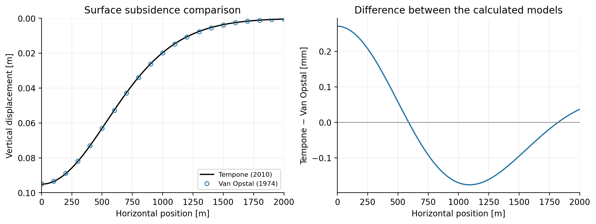

# Reservoir subsidence

A self-contained [Jupyter notebook](subsidence.ipynb) implementing and comparing Geertsma–Van Opstal (1974) and Tempone, Fjær & Landrø (2010) reservoir subsidence models.

```bash
pip install -r requirements.txt
jupyter lab subsidence.ipynb
```

Run the notebook from the repository root. It contains all equations and calculation functions, the comparison, and an example using `data/input.csv`. The comparison is self-contained. A coefficient-fitting section extends Van Opstal to prescribed Poisson ratios using TNO Appendix A as the methodological reference; all coefficients are calculated here rather than copied from TNO. Inputs are assumed valid; there are no tests or input-validation routines.

The calculated centre subsidence is 95.101 mm for Tempone and 94.830 mm for Van Opstal. Their maximum profile difference is 0.271 mm. 



In the last section, the dataset assigns each source cell a location and area, reservoir depth and thickness, pressure depletion, compaction coefficient, and basement-depth factor. For each cell, the notebook estimates the compacted volume as cell area × thickness × compaction coefficient × pressure depletion. It then calculates that cell’s contribution to surface subsidence at each map location and sums the contributions from all cells to produce the total subsidence map and profile. This summation assumes linear superposition.

# References 

Geertsma, J. (1973). *A basic theory of subsidence due to reservoir compaction:
  the homogeneous case*. Verhandelingen KNGMG 28, 43–62.
  
Tempone, P., Fjær, E. & Landrø, M. (2010). *Improved solution of displacements due to
  a compacting reservoir over a rigid basement*. Applied Mathematical Modelling 34,  3352–3362.

TNO (2023). *The PySub Subsidence Model Framework: Technical Reference*,
  TNO2022_R11962, 14 March 2023, Appendix A.1–A.2.

Van Opstal, G.H.C. (1974). *The effect of base-rock rigidity on subsidence due to
  reservoir compaction*. Proceedings of the Third Congress of the ISRM, 1102–1111.

